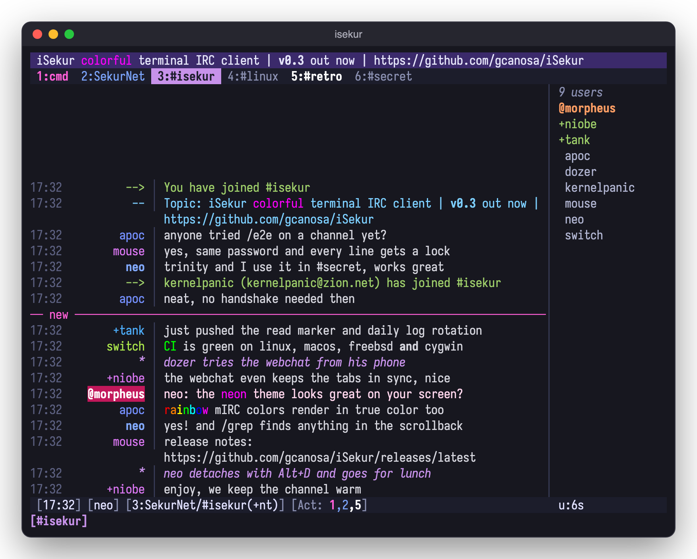

# iSekur 0.2

A small, very colorful terminal IRC client in C++17 with a built-in webchat
that mirrors your live session in a browser, bouncer style.

- Multiple servers and tabs, a topic bar, a status bar, a nicklist and an activity list
- 24-bit color themes in `themes/*.theme`, with a 256-color fallback (`/theme neon` switches live)
- TLS with certificate verification, plus IRCv3: CAP 302, SASL PLAIN / SCRAM-SHA-256 / EXTERNAL,
  server-time, echo-message, multi-prefix, away/account-notify, extended-join and more
- Per server: autoconnect, autojoin with channel keys (`/autojoin add` in a channel), SASL or
  `nickserv_pass` to identify on connect
- Webchat over HTTPS + WebSocket with login, PBKDF2 password hash and login lockout.
  Off unless you ask: `[web] autostart = on`, `isekur --web`, or `/web start` / `/web stop` while running
- Detach and attach like tmux: Alt+D (Option+D on a Mac) or `/detach` leaves it running, `isekur --attach`
  brings it back on any terminal; a closed window or a dropped SSH detaches instead of quitting
- `--daemon` starts it headless; attach from a terminal or the browser
- Mouse: click tabs, activity numbers and nicks, wheel scrolls chat and nicklist, drag copies text (OSC 52; F3 toggles). On the topic bar: the wheel scrolls it sideways, a click unfolds it, a double click edits it
- Flood-safe sending (pastes are queued so servers don't kick you; long pastes ask first) and `/ignore`
- `/grep [-all] text` searches the scrollback
- Channel op shortcuts: mass op/voice/kick, `/lockdown`, `/kickban`, `/tempban`, `/chanstats`, `/topicrotate`
- `/help` with colors, details and examples; commands complete with Tab as you type
- Auto-away when nothing is attached, and catch-up from IRCv3 chathistory on join
- Webchat notifications for highlights and private messages (the bell button)
- A "new" marker above the first message you missed, shared by the terminal and the webchat
- Optional chat logs (`log = on`, rotated daily) and CTCP VERSION/TIME/PING replies you can switch on or off, globally or per server

## Build

Needs a C++17 compiler, GNU make and OpenSSL 1.1+/LibreSSL. termbox2 is vendored.

    make            # gmake on *BSD
    make test
    ./isekur        # or: ./isekur -c path/to/isekur.conf
    sudo make install            # /usr/local; PREFIX=... must match the build
    man isekur

Copy `iSekur.conf.example` to `~/.config/isekur/isekur.conf`, or change
settings from inside the client with `/set theme neon`, `/set server.libera.autojoin #a,#b`
and write them back with `/save` (comments in the file are kept). Changes apply
right away; server settings are used on the next `/connect`, `[web]` after `/web stop` + `/web start`. Run
`./isekur --hash-password` to get the `[web] password_hash` value.

## Detach and attach

iSekur runs like a tmux session: the IRC side lives in a background process and the terminal is
only attached to it.

    isekur              # start (or, if it's already running, attach to it)
    Alt+D / /detach     # back to the shell; still connected, still in the channels, still logging
    isekur --attach     # back again, from this or any other terminal or SSH login
    isekur --daemon     # start in the background without attaching

Closing the terminal or losing the SSH connection detaches too. One terminal is attached at a time;
`/quit` ends it for real. It works through a socket next to the config (`isekur.sock`, only for your
user); output from the background goes to `isekur.log` there. On Linux servers where systemd kills
your processes at logout (`KillUserProcesses=yes`), run `loginctl enable-linger $USER` once.
Not available on Cygwin.

## Keys

| Key | Action |
|---|---|
| Alt+1..9, Alt+0 | go to tab N |
| Alt+←/→, Ctrl+P/N | previous / next tab |
| Ctrl+A, Alt+A | next tab with activity |
| Alt+D (Option+D on a Mac) | detach: iSekur keeps running in the background |
| Ctrl+X | next server |
| Ctrl+W | close tab (parts the channel) |
| PgUp / PgDn | scroll |
| Ctrl+L, Alt+L (Option+L on a Mac), F2 | show / hide the nicklist |
| Ctrl+T, Alt+T (Option+T on a Mac) | show / hide the topic bar |
| F3 | toggle mouse (drag copies; Shift+drag is the terminal's own selection) |
| right click on a nick | menu: query, whois, CTCPs, ignore, and op / voice / kick / ban when your rank allows (Up/Down/Enter or click) |
| Tab | complete a command after `/`, a command after `/help`, the key after `/set`, or a nick (matches are listed as you type) |
| Home / End, Ctrl+E, Ctrl+U / K | start / end of line, end of line, delete to start / end |
| Alt(Option)+Backspace | delete the previous word |
| Cmd+Backspace, Cmd+←/→ | delete to start, start / end (when the terminal forwards Cmd) |
| Ctrl+B / C / O / V / ] / _ | bold, color, reset, reverse, italic, underline |

Rebind any of the actions in the `[keys]` section (`D-` is Cmd, `M-` Alt, `C-` Ctrl).

Keys sent in the extended formats (tmux `extended-keys`, iTerm2/kitty/Ghostty/WezTerm
CSI u, xterm `modifyOtherKeys`) are decoded too, and unknown escape sequences are
dropped instead of showing up as garbage.

## Commands

`/server host [port] [-tls] [-noverify]`, `/connect`, `/disconnect`, `/join`, `/part`,
`/msg`, `/query`, `/me`, `/notice`, `/nick`, `/topic`, `/quiet [on|off]` (hide joins/parts/quits/nick changes in this tab), `/close`, `/win N`, `/raw`, `/ctcp`,
`/theme`, `/set [section.]key [value]`, `/save`, `/ignore [mask]`, `/unignore mask`, `/grep [-all] text`, `/web [start|stop|status]`,
`/clear`, `/quit`. Any other command goes to the server unchanged
(`/whois`, `/mode`, `/away`, ...).

Channel op shortcuts: `/massop`, `/massdeop`, `/massvoice`, `/massdevoice`,
`/masskick [-yes] [reason]` (asks first), `/lockdown` (+mntsi) and `/unlock` (-msi),
`/kickban nick [reason]` (bans `*!*@host`), `/tempban nick minutes [reason]` (lifted by iSekur when
the time is up), `/chanstats`, and `/topicrotate minutes topic | topic ...` (`off` stops it).

`/help` lists every command by group, in color; `/help <command>` explains it with examples.
Type `/` and the matching commands show up above the input line; Tab completes them.
