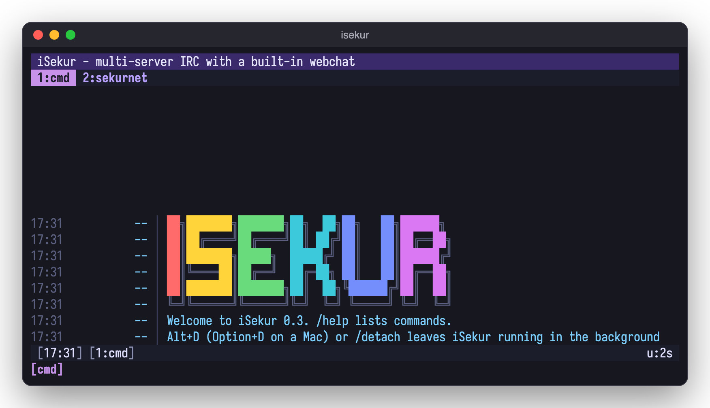
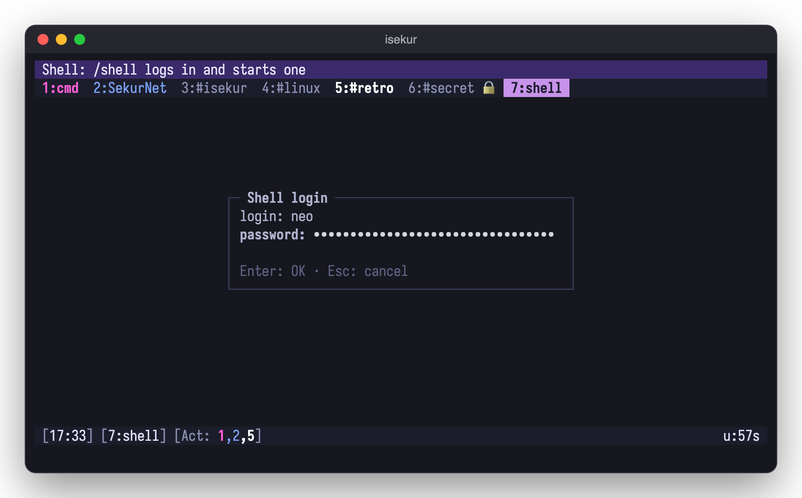
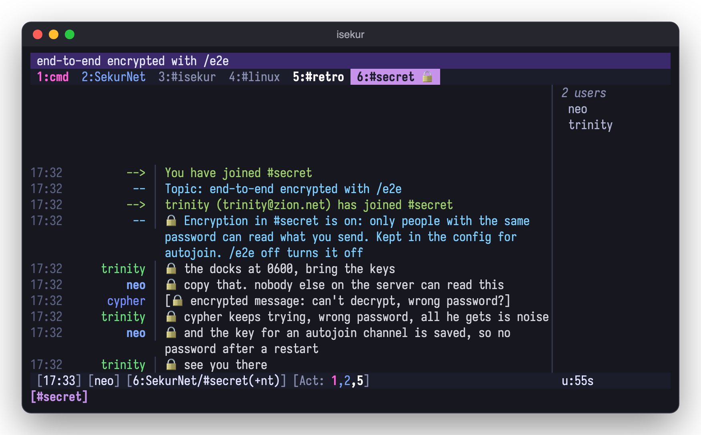

# iSekur 0.3

A small, very colorful terminal IRC client in C++17 with a built-in webchat
that mirrors your live session in a browser, bouncer style.

- Multiple servers and tabs, a topic bar, a status bar, a nicklist and an activity list
- 24-bit color themes in `themes/*.theme`, with a 256-color fallback (`/theme neon` switches live): default, neon,
  dracula, tokyonight, catppuccin-mocha, gruvbox, nord, onedark, rose-pine, kanagawa, solarized, and light ones:
  tokyonight-day, catppuccin-latte, gruvbox-light, rose-pine-dawn, solarized-light, github-light
- TLS with certificate verification, plus IRCv3: CAP 302, SASL PLAIN / SCRAM-SHA-256 / EXTERNAL,
  server-time, echo-message, multi-prefix, away/account-notify, extended-join and more
- Per server: autoconnect, autojoin with channel keys (`/autojoin add` in a channel, `/autojoin snap` saves every open channel), SASL or
  `nickserv_pass` to identify on connect
- Webchat over HTTPS + WebSocket with login, PBKDF2 password hash and login lockout.
  Off unless you ask: `[web] autostart = on`, `isekur --web`, or `/web start` / `/web stop` while running
- Detach and attach like tmux: Alt+D (Option+D on a Mac) or `/detach` leaves it running, `isekur --attach`
  brings it back on any terminal; a closed window or a dropped SSH detaches instead of quitting
- `--daemon` starts it headless; attach from a terminal or the browser
- Mouse: click tabs, activity numbers and nicks, wheel scrolls chat and nicklist, drag copies text (OSC 52; F3 toggles). On the topic bar: the wheel scrolls it sideways, a click unfolds it, a double click edits it
- Flood-safe sending (pastes are queued so servers don't kick you; long pastes ask first) and `/ignore`
- Highlights on your nick plus your own words (`/hilight add isekur`, `*` globs), and quit/part messages you can set (`quit_message`, `part_message`)
- `/grep [-all] text` searches the scrollback
- Channel op shortcuts: mass op/voice/kick, `/lockdown`, `/kickban`, `/tempban`, `/chanstats`, `/topicrotate`
- `/help` with colors, details and examples; commands complete with Tab as you type
- Auto-away when nothing is attached, and catch-up from IRCv3 chathistory on join
- Webchat notifications for highlights and private messages (the bell button)
- A "new" marker above the first message you missed, shared by the terminal and the webchat
- The webchat has the same nick and channel tab menus (right click or long press on a nick or a channel tab), folding networks, Alt+A for the next active tab and the theme's tab colors
- `/set` alone opens a settings window in the terminal: every key by category, `/` to search, `e` to edit in place, Space to switch on/off or step through the themes, `s` saves (the webchat's ⚙ has switches and a theme list)
- Webchat buttons at the bottom left: + adds a server (host, port, TLS, network name, nick), ⚙ edits every setting in place (Apply, or Apply & save to the config), ⓘ is /about
- `/list` opens a sortable channel table in its own tab (click Channel or Users); double click a #channel anywhere to join it
- The status bar can show CPU, memory, load and a battery next to the uptime (`/statusbar`), colored by thresholds you can change (`cpu_levels`, `mem_levels`) and by the theme
- Optional chat logs (`log = on`, rotated daily) and CTCP VERSION/TIME/PING replies you can switch on or off, globally or per server

## Download

Prebuilt packages of the latest release (the links always point at the newest one):
[macOS, Apple silicon](https://github.com/gcanosa/iSekur/releases/latest/download/isekur-macos-arm64.tar.gz),
[Linux x86_64](https://github.com/gcanosa/iSekur/releases/latest/download/isekur-linux-x86_64.tar.gz),
[Linux arm64](https://github.com/gcanosa/iSekur/releases/latest/download/isekur-linux-arm64.tar.gz) (both need libssl3),
[source](https://github.com/gcanosa/iSekur/releases/latest/download/isekur-src.tar.gz).

    curl -L https://github.com/gcanosa/iSekur/releases/latest/download/isekur-macos-arm64.tar.gz | tar xz
    sudo isekur-macos-arm64/install.sh     # /usr/local

## Install

macOS (Homebrew):

    brew install gcanosa/isekur/isekur
    isekur          # start it
    man isekur      # the manual
    brew upgrade isekur          # update to the latest release

## Build

Needs a C++17 compiler, GNU make, OpenSSL 1.1+/LibreSSL and PAM (libpam0g-dev on Debian/Ubuntu). termbox2 and libvterm are vendored.

    make            # gmake on *BSD
    make test
    ./isekur        # or: ./isekur -c path/to/isekur.conf
    sudo make install            # /usr/local; PREFIX=... must match the build
    man isekur

On the first start iSekur writes `~/.config/isekur/isekur.conf` with every setting at its
default (the example servers commented out, an empty value means the default), so you can edit
it by hand, or change settings from inside the client with `/set theme neon`, `/set server.libera.autojoin #a,#b`
and write them back with `/save` (comments in the file are kept). Changes apply
right away; server settings are used on the next `/connect`, `[web]` after `/web stop` + `/web start`. Run
`./isekur --hash-password` to get the `[web] password_hash` value.

## Detach and attach

iSekur runs like a tmux session: the IRC side lives in a background process and the terminal is
only attached to it.

    isekur              # start (or, if it's already running, attach to it)
    Alt+D / /detach     # back to the shell; still connected, still in the channels, still logging
    isekur --attach     # back again, from this or any other terminal or SSH login
    isekur --daemon     # start in the background without attaching

Closing the terminal or losing the SSH connection detaches too. One terminal is attached at a time;
`/quit` ends it for real. It works through a socket next to the config (`isekur.sock`, only for your
user); output from the background goes to `isekur.log` there. On Linux servers where systemd kills
your processes at logout (`KillUserProcesses=yes`), run `loginctl enable-linger $USER` once.
Not available on Cygwin.

## Keys

| Key | Action |
|---|---|
| Alt+1..9, Alt+0 | go to tab N |
| Alt+←/→, Ctrl+P/N | previous / next tab |
| Ctrl+A, Alt+A | next tab with activity |
| Alt+D (Option+D on a Mac) | detach: iSekur keeps running in the background |
| Ctrl+X | next server |
| Ctrl+W | close tab (parts the channel) |
| PgUp / PgDn | scroll |
| Ctrl+L, Alt+L (Option+L on a Mac), F2 | show / hide the nicklist |
| Ctrl+T, Alt+T (Option+T on a Mac) | show / hide the topic bar |
| F3 | toggle mouse (drag copies; Shift+drag is the terminal's own selection) |
| Cmd+click (Ctrl+click on Linux) on a link | opens it: links in messages and the topic are terminal hyperlinks (OSC 8), also when they wrap onto the next line. If your terminal gives the click to iSekur, hold Shift too or turn the mouse off with F3. In tmux: `set -as terminal-features ",*:hyperlinks"` |
| right click on a nick | menu: query, whois, CTCPs, ignore, op / voice / kick / ban when your rank allows, kill / G-line when you are an IRC operator (Up/Down/Enter or click) |
| right click on a channel tab | menu: quiet mode on/off, clear, add to or remove from autojoin, close (asks before leaving a joined channel); same in the webchat |
| right click on a server tab | hide or show its channels and queries in the tab bar ("+N" counts them, colored by their activity); Ctrl+N/P, Ctrl+A and `/win` still reach them; in the webchat click the network name (both stay in sync) |
| Tab | complete a command after `/`, a command after `/help`, the key after `/set`, or a nick (matches are listed as you type) |
| Up / Down while matches are listed | move through them; Enter or Tab puts the highlighted one in the input line without sending |
| Home / End, Ctrl+E, Ctrl+U / K | start / end of line, end of line, delete to start / end |
| Alt(Option)+Backspace | delete the previous word |
| Cmd+Backspace, Cmd+←/→ | delete to start, start / end (when the terminal forwards Cmd) |
| Ctrl+B / C / O / V / ] / _ | bold, color, reset, reverse, italic, underline |

Rebind any of the actions in the `[keys]` section (`D-` is Cmd, `M-` Alt, `C-` Ctrl).

Keys sent in the extended formats (tmux `extended-keys`, iTerm2/kitty/Ghostty/WezTerm
CSI u, xterm `modifyOtherKeys`) are decoded too, and unknown escape sequences are
dropped instead of showing up as garbage.

## Commands

`/server host [port] [-tls] [-noverify]`, `/connect`, `/disconnect`, `/join`, `/part`,
`/msg`, `/query`, `/me`, `/notice`, `/nick`, `/topic`, `/quiet [on|off]` (hide joins/parts/quits/nick changes in this tab), `/close`, `/win N`, `/raw`, `/ctcp`,
`/theme`, `/set [section.]key [value]`, `/save`, `/reload` (re-read the config file), `/ignore [mask]`, `/unignore mask`, `/hilight [add|del] word`, `/grep [-all] text`, `/web [start|stop|status]`,
`/clear`, `/quit`. Any other command goes to the server unchanged
(`/whois`, `/mode`, `/away`, ...).

Channel op shortcuts: `/massop`, `/massdeop`, `/massvoice`, `/massdevoice`,
`/masskick [-yes] [reason]` (asks first), `/lockdown` (+mntsi) and `/unlock` (-msi),
`/kickban nick [reason]` (bans `*!*@host`), `/tempban nick minutes [reason]` (lifted by iSekur when
the time is up), `/chanstats`, and `/topicrotate minutes topic | topic ...` (`off` stops it).

Shell commands: `/exec ls -la` (alias `/sh`) streams the output into the cmd tab without blocking
the chat; `/exec -o uptime` says it in the current channel or query (longer than `paste_confirm`
lines needs `-y`). Commands are killed after `exec_timeout` seconds; the webchat can't run them
unless `exec_web = on`.

Files (DCC): what's sent to you is only offered until you `/dcc get` it; it downloads in the
background into `dcc_dir` (default `~/Downloads`, on the machine iSekur runs on), and a broken
download resumes where it stopped. `/dcc send nick file` offers one (behind a router set `dcc_ip`
and forward `dcc_ports`). Progress shows in the status bar and the webchat; `/dcc` lists the
transfers, `/dcc close n` refuses or cancels one. With `dcc_web = on` the webchat's Files window
(⇅) downloads what's in `dcc_dir` to your own computer, seedbox style, so iSekur on a VPS can
fetch files for you. Passive DCC is not there yet.

`/shell` opens a real terminal in a tab (its own color, `tab_shell` in the theme) after asking
for this machine's login and password, checked by the system through PAM (`pam_service`,
default `login`; three wrong ones lock it for a minute). It runs your `$SHELL` as a login shell
on a pty, so vim, top, ssh, Ctrl+C and tab completion work. Every key goes to it but Alt+←/→
and Alt+1-9, which move between tabs; the mouse wheel scrolls back through what went off the
top. `exit` ends it, Ctrl+W then closes the tab (closing a tab with a running shell hangs it up).
It is never reachable from the webchat or from IRC: only from the terminal iSekur runs in.

`/lock on` sets a master password (off by default): from then on iSekur shows only a password
box at startup, on every `--attach` and after `/lock`, before any tab, log or message. It's
stored hashed in the config; three wrong tries wait a minute; `/lock off` asks for it before
turning it off, and `/lock on` again changes it (current password first). Forgot it? Stop
iSekur (`pkill isekur`), set `lock = off` in the config and start it again. It locks the screen, not the files: the config and logs aren't encrypted, and
the webchat keeps its own login.

IRC operators: `/oper user` asks for the password (hidden). While you are +o or +s, server
notices (`*** ...`) and WALLOPS go to a `*snotices` tab. `/kill`, `/gline`, `/kline`, `/zline`,
`/shun`, `/wallops`, `/away`, `/kick` and friends take the reason as plain words (iSekur adds the
`:`); `/help` has an "IRC operator" section.

Encrypted queries between two iSekur users: `/e2e nick` (alias `/sq`) asks for a password
(typed hidden) and invites nick, who accepts with `/e2e yournick` and the same password. A
matching password turns on AES-256-GCM (key = scrypt of the password) for that query and both
sides see 🔒; a wrong one is reported to both and nothing is encrypted. Keys are kept in memory
only. `/e2e off` ends it. With `--daemon` the decryption happens in the daemon, so the webchat
shows plain text (and the browser input does not hide the password).

Encrypted channels: `/e2e #chan` (or "Turn on E2E" in the channel tab's right click menu) asks
for a password and encrypts what you say there. Everyone who typed the same password reads it,
marked 🔒 per line and on the tab; everyone else sees `+iSE` noise. There is no handshake, so
a wrong password is only noticed when the others' lines don't open. Anyone with the password
reads everything: to drop someone, change it. `/e2e off` in the channel turns it off. For an
autojoin channel the key is saved in the config (`e2e_keys`, the scrypt key, not the password),
so a restart doesn't ask again; the file is 0600, and whoever can read it can read the channel.

`/help` lists every command by group, in color; `/help <command>` explains it with examples.
Type `/` and the matching commands show up above the input line; Tab completes them.
`/about` shows the version and where to find iSekur.

## Support

Questions, bugs and ideas: **#iSekur** on **irc.sekurnet.org**, iSekur's sponsored network
(`/server irc.sekurnet.org 6697 -tls -name sekurnet`, then `/join #iSekur`), or a GitHub issue.

## License

GPL-3.0-or-later, see [LICENSE](LICENSE). You can use, change and share iSekur, but copies and
modified versions you give to others must stay under the GPL with their source code, and keep the
copyright notice. Copyright (C) 2026 Gerardo Canosa. The vendored termbox2 is MIT.
