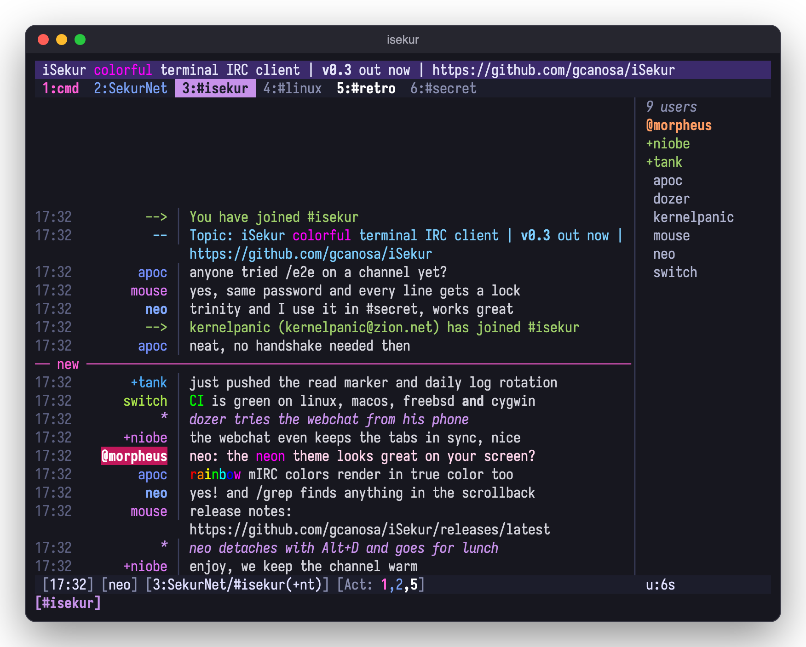
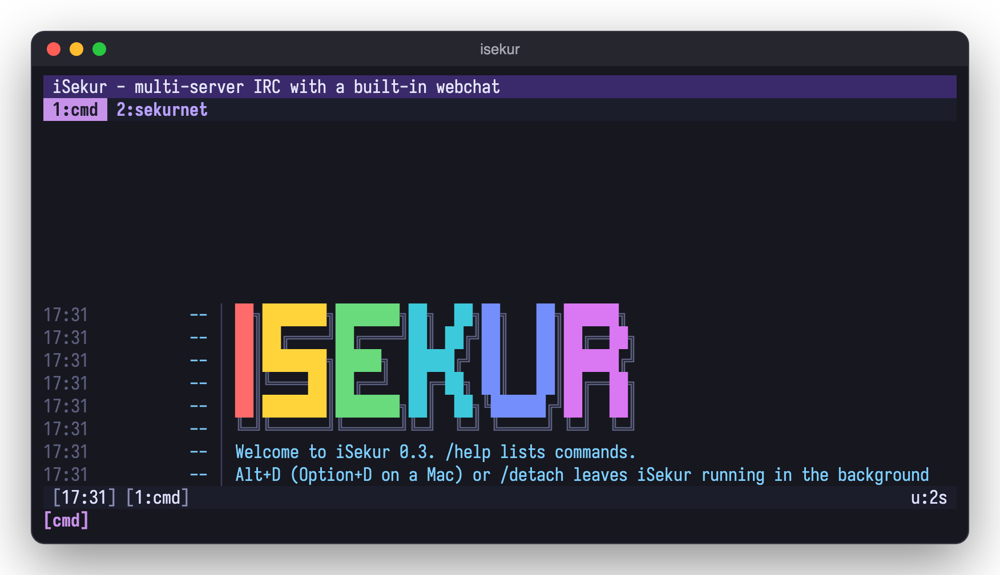
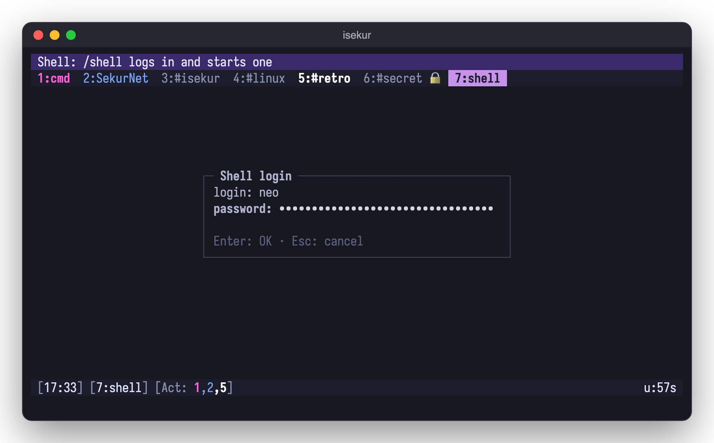
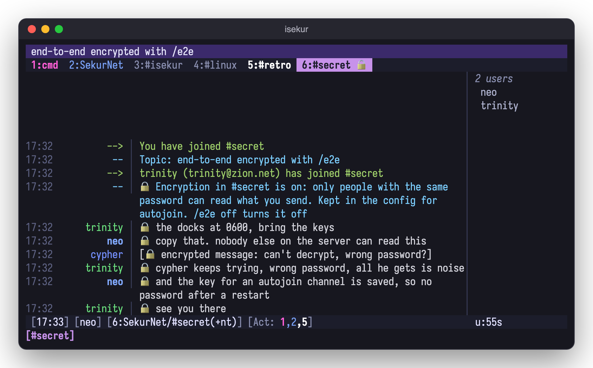

# iSekur 0.5.1

A small, very colorful terminal IRC client in C++17 with a built-in webchat
that mirrors your live session in a browser, bouncer style.

**Website: [gcanosa.github.io/isekur-site](https://gcanosa.github.io/isekur-site/)**, with a live theme switcher and more screenshots.

- Multiple servers and tabs, a topic bar, a status bar, a nicklist and an activity list
- 37 24-bit color themes in `themes/*.theme`, with a 256-color fallback (`/theme` alone opens a live picker):
  - dark: default, neon, dracula, tokyonight, catppuccin-mocha, gruvbox, nord, onedark, rose-pine, kanagawa, solarized,
    github-dark, everforest, ayu, nightfox, night-owl, material, contrast-dark (high contrast)
  - light: tokyonight-day, catppuccin-latte, gruvbox-light, rose-pine-dawn, solarized-light, github-light, one-light,
    kanagawa-lotus, nord-light, everforest-light, ayu-light, dayfox, light-owl, material-lighter, contrast-light (high contrast)
  - mirc / mirc-dark: the classic mIRC look
  - mono / mono-light: no colors at all, greys only (nicks one grey, mIRC color codes in messages shown plain)
- TLS with certificate verification, plus IRCv3: CAP 302, SASL PLAIN / SCRAM-SHA-256 / EXTERNAL,
  server-time, echo-message, multi-prefix, away/account-notify, extended-join, account-tag, chghost, setname,
  STS (a server that asks for TLS gets it, and keeps getting it), labeled-response, standard replies,
  CASEMAPPING, WHOX (accounts, real names and bots in the nick list), bot mode, UTF8ONLY (a stray Latin-1 byte is re-encoded, not refused), MONITOR (`/notify`),
  replies and reactions (`/reply`, `/react`), typing notifications both ways (`send_typing`), multiline
  pastes, message redaction (`/redact`), read markers synced with your other clients, channel renames,
  and account registration (`/register`, `/verify`)
- Per server: autoconnect, autojoin with channel keys (`/autojoin add` in a channel, `/autojoin snap` saves every open channel), SASL or
  `nickserv_pass` to identify on connect (`auto_identify = false` turns that off)
- Webchat over HTTPS + WebSocket with login, PBKDF2 password hash and login lockout.
- The webchat installs as an app (PWA: home screen or dock, notifications on Android and on an installed
  iPhone webchat). That needs a trusted certificate (`cert`/`key` in `[web]`, e.g. Let's Encrypt or
  `tailscale cert`) or localhost: with the self-signed one it stays a plain web page.
  Off unless you ask: `[web] autostart = on`, `isekur --web`, or `/web start` / `/web stop` while running
- Detach and attach like tmux: Alt+D (Option+D on a Mac) or `/detach` leaves it running, `isekur --attach`
  brings it back on any terminal; a closed window or a dropped SSH detaches instead of quitting
- `--daemon` starts it headless; attach from a terminal or the browser
- Mouse: click tabs and activity numbers, double click a nick for a private chat (a click selects it, Shift or Ctrl+click adds more, right click acts on them all: op, voice, kick), wheel scrolls chat and nicklist, drag copies text (OSC 52; F3 toggles). On the topic bar: the wheel scrolls it sideways, a click unfolds it, a double click opens it in a box to edit (when you may change it: ops on +t channels)
- Flood-safe sending (pastes are queued so servers don't kick you; long pastes ask first) and `/ignore`
- Highlights on your nick plus your own words (`/hilight add isekur`, `*` globs), and quit/part messages you can set (`quit_message`, `part_message`)
- `/grep [-all] text` searches the scrollback
- Channel op shortcuts: mass op/voice/kick, `/lockdown`, `/kickban`, `/tempban`, `/chanstats`, `/topicrotate`
- `/help` with colors, details and examples; commands complete with Tab as you type
- Lua plugins, sandboxed, from a checked catalog (`/plugin install`), on everywhere or per network or channel; auto-away is one (`/plugin install autoaway`)
- Catch-up from IRCv3 chathistory on join
- Webchat notifications for highlights and private messages (the bell button)
- A "new" marker above the first message you missed, shared by the terminal and the webchat
- The webchat has the same nick, channel tab and server tab menus (right click or long press on a nick or a tab), a × on the hovered tab to close it (it asks before leaving a channel or disconnecting), folding networks, Alt+A for the next active tab and the theme's tab colors
- It also has the terminal's input line and status bar: live suggestions (`/jo`, `/set key`, `/help k`; Up/Down, Tab), hidden password prompts (`/oper`, `/e2e`; Esc cancels, never in the history), pastes with newlines shown as ↵ and `paste_confirm`, mIRC formatting keys (Ctrl+B, Ctrl+C without a selection, Ctrl+O, Ctrl+R, Ctrl+I, Ctrl+U), clock, user modes, lag, clickable `[Act: ...]`, `-- MORE --` and `status_info`, double click the topic to edit it, the bell, and your `[keys]` bindings (Alt+W closes a tab and Alt+X goes to the next server, since browsers keep Ctrl+W and Ctrl+X)
- `/set` alone opens a settings window in the terminal: Global by topic, then each network with its own keys and every Global one it can override (shown as inherited or overriding), `/` to search, `e` to edit in place, Space to switch on/off or step through the themes, `s` saves (the webchat's ⚙ has switches and a theme list); `/set key ""` puts a key's default back
- Webchat buttons at the bottom left: + adds a server (host, port, TLS, network name, nick), ⚙ edits every setting in place (Apply, or Apply & save to the config), ⓘ is /about
- `/list` opens a sortable channel table in its own tab (click Channel or Users); double click a #channel anywhere to join it
- The status bar can show CPU, memory, load and a battery next to the uptime (`/statusbar`), colored by thresholds you can change (`cpu_levels`, `mem_levels`) and by the theme
- Optional chat logs (`log = on`, rotated daily) and `/logs`, a browser for them: network, channel and day in a tree, a calendar, and a search over every day; without them, tabs still show their last lines after a restart (`keep_history`). CTCP VERSION/TIME/PING replies you can switch on or off, globally or per server

Six of the 37 themes, same chat (mIRC, Rosé Pine, Ayu, Neon, Catppuccin Latte, Dracula):

| | |
|---|---|
|  |  |
|  |  |
|  |  |

The webchat, the same live session in a browser or on a phone (here in Rosé Pine, and mIRC with its Windows 95 dialogs):

| | |
|---|---|
|  |  |

## Download

Prebuilt packages of the latest release (the links always point at the newest one):
[macOS, Apple silicon](https://github.com/gcanosa/iSekur/releases/latest/download/isekur-macos-arm64.tar.gz),
[Linux x86_64](https://github.com/gcanosa/iSekur/releases/latest/download/isekur-linux-x86_64.tar.gz),
[Linux arm64](https://github.com/gcanosa/iSekur/releases/latest/download/isekur-linux-arm64.tar.gz) (both need libssl3),
[source](https://github.com/gcanosa/iSekur/releases/latest/download/isekur-src.tar.gz).

    curl -L https://github.com/gcanosa/iSekur/releases/latest/download/isekur-macos-arm64.tar.gz | tar xz
    sudo isekur-macos-arm64/install.sh     # /usr/local

## Install

macOS (Homebrew):

    brew install gcanosa/isekur/isekur
    isekur          # start it
    man isekur      # the manual
    brew upgrade isekur          # update to the latest release

## Build

Needs a C++17 compiler, GNU make, OpenSSL 1.1+/LibreSSL and PAM (libpam0g-dev on Debian/Ubuntu). termbox2 and libvterm are vendored.

    make            # gmake on *BSD
    make test
    make notwitch   # without Twitch chat support (/twitch then says so)
    ./isekur        # or: ./isekur -c path/to/isekur.conf
    sudo make install            # /usr/local; PREFIX=... must match the build
    man isekur

On the first start iSekur writes `~/.config/isekur/isekur.conf` with every setting at its
default (the example servers commented out, an empty value means the default), so you can edit
it by hand, or change settings from inside the client with `/set theme neon`, `/set server.sekurnet.autojoin #a,#b`
and write them back with `/save` (comments in the file are kept). Changes apply
right away; server settings are used on the next `/connect`, `[web]` after `/web stop` + `/web start`. Run
`./isekur --hash-password` to get the `[web] password_hash` value.

The first start also opens the **first steps guide** (`*guide` tab): your nick, a first server,
channels, keys, settings, the webchat and safety, on pages you turn with ← → or Prev/Next.
Its "Don't show this at startup" box sets `show_guide = off`; `/guide` opens it again any time.

## Detach and attach

iSekur runs like a tmux session: the IRC side lives in a background process and the terminal is
only attached to it.

    isekur              # start (or, if it's already running, attach to it)
    Alt+D / /detach     # back to the shell; still connected, still in the channels, still logging
    isekur --attach     # back again, from this or any other terminal or SSH login (none running: a new one starts)
    isekur --daemon     # start in the background without attaching
    isekur --list       # the ones running, and the command that attaches each
    /attach host        # inside iSekur: another machine's iSekur, live in a tab (over ssh; -p 2222 for another port)

Several sessions side by side: one config each, in the same folder or not
(`isekur -c ~/.config/isekur/work.conf`, Alt+D, then `isekur -c ~/.config/isekur/fun.conf`...).
`isekur --list` shows which are running; `isekur -c work.conf --attach` picks one here,
`/attach host ~/.config/isekur/work.conf` one on another machine (in a tab named `host:work`;
`ssh host isekur --list` shows what runs there).

Closing the terminal or losing the SSH connection detaches too. One terminal is attached at a time;
`/exit` ends it for real. It works through a socket next to the config, named after it
(`isekur.sock` for `isekur.conf`, `work.sock` for `work.conf`, only for your user); output from the
background goes to `isekur.log` (`work.log`) there. On Linux servers where systemd kills
your processes at logout (`KillUserProcesses=yes`), run `loginctl enable-linger $USER` once.
Not available on Cygwin.

## Keys

`/keys`, F1 or Alt+K (Option+K on a Mac) shows all of them in a window, drawn as keycaps by group, your own `[keys]` bindings included (terminal and webchat).

| Key | Action |
|---|---|
| F1, Alt+K | the key list (`/keys`) |
| Alt+1..9, Alt+0 | go to tab N |
| Alt+←/→, Ctrl+P/N | previous / next tab |
| Ctrl+A, Alt+A | next tab with activity |
| Alt+S (Option+S on a Mac) | lock the terminal and the webchat now (`/lock`; with no lock password yet it says how to set one) |
| Alt+D (Option+D on a Mac), Ctrl+Z | detach: iSekur keeps running in the background |
| Ctrl+X | next server |
| Ctrl+G, Alt+J | find a tab: type part of a channel, nick or network name, Enter goes there (the webchat's filter box on top of the tab list) |
| Ctrl+W | close tab (parts the channel) |
| PgUp / PgDn | scroll |
| Ctrl+L, Alt+L (Option+L on a Mac), F2 | show / hide the nicklist |
| Ctrl+T, Alt+T (Option+T on a Mac) | show / hide the topic bar |
| F3 | toggle mouse (drag copies; Shift+drag is the terminal's own selection) |
| Cmd+click (Ctrl+click on Linux) on a link | opens it: links in messages and the topic are terminal hyperlinks (OSC 8), also when they wrap onto the next line. If your terminal gives the click to iSekur, hold Shift too or turn the mouse off with F3. In tmux: `set -as terminal-features ",*:hyperlinks"` |
| right click on a nick | menu: query, whois, CTCPs, ignore, op / voice / kick / ban when your rank allows, kill / G-line when you are an IRC operator (Up/Down/Enter or click) |
| right click on a channel tab | menu: quiet mode on/off, clear, add to or remove from autojoin, close (asks before leaving a joined channel); same in the webchat |
| right click on a server tab | menu: connect, or reconnect / disconnect; hide or show its channels and queries in the tab bar ("+N" counts them, colored by their activity; Ctrl+N/P, Ctrl+A and `/win` still reach them; `/fold`, or in the webchat a click on the ▾ next to the network name); close (asks while connected); same in the webchat |
| Tab | complete a command after `/`, a command after `/help`, the key after `/set`, or a nick (matches are listed as you type; a nick first on the line gets `complete_suffix`, `bob: `; on phones the webchat lists the nicks to tap) |
| Up / Down while matches are listed | move through them; Enter or Tab puts the highlighted one in the input line without sending |
| Home / End, Ctrl+E, Ctrl+U / K | start / end of line, end of line, delete to start / end |
| Alt(Option)+Backspace | delete the previous word |
| Cmd+Backspace, Cmd+←/→ | delete to start, start / end (when the terminal forwards Cmd) |
| Ctrl+B / C / O / V / ] / _ | bold, color (shown as ◆ in that color), reset, reverse, italic, underline. Ctrl+C on an empty line doesn't quit: it reminds you of /exit and Ctrl+Z / Alt+D |

Rebind any of the actions in the `[keys]` section (`D-` is Cmd, `M-` Alt, `C-` Ctrl).

Keys sent in the extended formats (tmux `extended-keys`, iTerm2/kitty/Ghostty/WezTerm
CSI u, xterm `modifyOtherKeys`) are decoded too, and unknown escape sequences are
dropped instead of showing up as garbage.

## Commands

`/server host [port] [-tls] [-noverify]`, `/server rename old new`, `/connect`, `/disconnect`, `/join`, `/part`,
`/msg`, `/query`, `/me`, `/notice`, `/nick`, `/topic`, `/quiet [on|off]` (hide joins/parts/quits/nick changes in this tab), `/close`, `/win N`, `/raw`, `/rawlog [on|off]` (a *raw tab with every line to and from the server, passwords blanked), `/ctcp`,
`/theme`, `/keys`, `/set [section.]key [value]`, `/save`, `/reload` (re-read the config file), `/ignore [mask]`, `/unignore mask`, `/hilight [add|del] word`, `/grep [-all] text`, `/logs [text]` (the log browser, below), `/web [start|stop|status]`,
`/clear`, `/back` (clears away), `/quit` (this tab's server), `/exit [-y]` (close iSekur; asks while connected, and for the lock password when one is set). Any other command goes to the server unchanged
(`/whois`, `/mode`, `/away`, ...).

Twitch chat is IRC: `/twitch` opens its tab and asks for your login and OAuth token if they're missing, or set up a `[server.twitch]` with `host = irc.chat.twitch.tv`, `port = 6697`, `tls = true`,
`nick = yourlogin` and `password = oauth:yourtoken` (see `iSekur.conf.example`), then `/join #streamer`.
Display names, name colors, mod/VIP badges (`@`/`+`), subs, raids, timeouts and room modes are shown.

Getting a token (`/twitch token` shows these steps too):
1. At [dev.twitch.tv/console](https://dev.twitch.tv/console) register an application: OAuth Redirect URL
   `http://localhost` (exactly), Category *Chat Bot*, Client Type *Public*. Copy its **Client ID**.
2. Open, with your Client ID in place of `YOUR_CLIENT_ID`:
   `https://id.twitch.tv/oauth2/authorize?response_type=token&client_id=YOUR_CLIENT_ID&redirect_uri=http://localhost&scope=chat:read+chat:edit`
3. Approve. The browser lands on a localhost page that doesn't load, which is fine: copy what follows
   `access_token=` in its address, up to the next `&`, and paste it when `/twitch` asks.

A channel is the streamer's name from `twitch.tv/<name>`: `/join name` (the `#` and lowercase are added).

Channel op shortcuts: `/massop`, `/massdeop`, `/massvoice`, `/massdevoice`,
`/masskick [-yes] [reason]` (asks first), `/lockdown` (+mntsi) and `/unlock` (-msi),
`/kickban nick [reason]` (bans `*!*@host`), `/tempban nick minutes [reason]` (lifted by iSekur when
the time is up), `/chanstats`, and `/topicrotate minutes topic | topic ...` (`off` stops it).

Shell commands: `/exec ls -la` (alias `/sh`) streams the output into the cmd tab without blocking
the chat; `/exec -o uptime` says it in the current channel or query (longer than `paste_confirm`
lines needs `-y`; `paste_confirm = 0` sends any length). Commands are killed after `exec_timeout` seconds; the webchat can't run them
unless `exec_web = on`.

Files (DCC): what's sent to you is only offered until you `/dcc get` it; it downloads in the
background into `dcc_dir` (default `~/Downloads`, on the machine iSekur runs on), and a broken
download resumes where it stopped. `/dcc send nick file` offers one (behind a router set `dcc_ip`
and forward `dcc_ports`). Progress shows in the status bar and the webchat; `/dcc` lists the
transfers, `/dcc close n` refuses or cancels one. With `dcc_web = on` the webchat's Files window
(⇅) downloads what's in `dcc_dir` to your own computer, seedbox style, so iSekur on a VPS can
fetch files for you. Passive DCC is not there yet.

`/shell` opens a real terminal in a tab (its own color, `tab_shell` in the theme) after asking
for this machine's login and password, checked by the system through PAM (`pam_service`,
default `login`; three wrong ones lock it for a minute). It runs your `$SHELL` as a login shell
on a pty, so vim, top, ssh, Ctrl+C and tab completion work. Every key goes to it but Alt+←/→
and Alt+1-9, which move between tabs; the mouse wheel scrolls back through what went off the
top. `exit` ends it, Ctrl+W then closes the tab (closing a tab with a running shell hangs it up).
It is never reachable from the webchat or from IRC: only from the terminal iSekur runs in.

`/attach host` does the same with `ssh -t host` and `isekur --attach` there (run through a login
shell, so a Homebrew `isekur` is found): the iSekur on that machine shows up live in a tab of this
one. `host` is a name, `user@host` or a `Host` from `~/.ssh/config` (put ports and keys there);
ssh asks for its own password or uses your keys, so no system login is asked first. Keys go to
the remote one except Alt+←/→ and Alt+1-9, so Alt+D or `/detach` typed in the tab detaches it
and leaves it running; `/attach host` again reconnects. If none runs there, a new one starts. The
mouse isn't passed on. `/attach host config` picks one of several iSekurs there (`isekur -c config
--attach`). From a plain terminal, `ssh -t host isekur --attach` is the same thing.

`/lock on` sets a master password (off by default): from then on iSekur shows only a password
box at startup, on every `--attach` and after `/lock`, before any tab, log or message. It's
stored hashed in the config; three wrong tries wait a minute; `/lock off` asks for it before
turning it off, `/lock on` again changes it (current password first), and `/exit` asks for it
too, so an unlocked terminal or an open webchat can't close iSekur (Alt+D still detaches). Forgot it? Stop
iSekur (`pkill isekur`), set `lock = off` in the config and start it again. It locks the screen, not the files: the config and logs aren't encrypted, and
the webchat keeps its own login.

IRC operators: `/oper user` asks for the password (hidden). While you are +o or +s, server
notices (`*** ...`) and WALLOPS go to a `*snotices` tab. `/kill`, `/gline`, `/kline`, `/zline`,
`/shun`, `/wallops`, `/away`, `/kick` and friends take the reason as plain words (iSekur adds the
`:`); `/help` has an "IRC operator" section.

Encrypted queries between two iSekur users: `/e2e nick` (alias `/sq`) asks for a password
(typed hidden) and invites nick, who accepts with `/e2e yournick` and the same password. A
matching password turns on AES-256-GCM (key = scrypt of the password) for that query and both
sides see 🔒; a wrong one is reported to both and nothing is encrypted. Keys are kept in memory
only. `/e2e off` ends it. With `--daemon` the decryption happens in the daemon, so the webchat
shows plain text (and the browser input does not hide the password).

Encrypted channels: `/e2e #chan` (or "Turn on E2E" in the channel tab's right click menu) asks
for a password and encrypts what you say there. Everyone who typed the same password reads it,
marked 🔒 per line and on the tab; everyone else sees `+iSE` noise. There is no handshake, so
a wrong password is only noticed when the others' lines don't open. Anyone with the password
reads everything: to drop someone, change it. `/e2e off` in the channel turns it off. For an
autojoin channel the key is saved in the config (`e2e_keys`, the scrypt key, not the password),
so a restart doesn't ask again; the file is 0600, and whoever can read it can read the channel.

Plugins: Lua 5.4 files in `plugins/` next to the config (`~/.config/isekur/plugins/<name>.lua`),
each in its own sandbox (no files, programs or sockets of its own; a runaway loop is stopped and
a plugin gets 32 MB at most). `/plugin available` lists the catalog ([isekur-plugins](https://github.com/gcanosa/isekur-plugins), its own repository; nothing of it comes with iSekur),
`/plugin install name` fetches one, checks its sha256 against the catalog and turns it on,
`/plugin update` and `/plugin remove name` the same way. The catalog is kept on disk (`.catalog.json`
in your plugins folder) and fetched again after 12 hours, or with `/plugin refresh`; an update is a
newer version than the `-- version:` line of the file you have. In the catalog so far: autoaway, awaylog (your highlights and PMs while you were away, summed up when
you're back) and seen (`/seen nick`, and `!seen` in channels you pick). Auto-away is a plugin now:
`/plugin install autoaway` moves your old `auto_away`, `auto_away_idle`, `away_message` and
`away_announce` settings into it and out of the config (`away_announce` becomes `announce_away` and
`announce_back`, each on or off on its own). `/plugin` alone opens the plugin window in the terminal
(the puzzle button in the webchat): Installed and Available tabs, on/off, install, update, remove, and
each plugin's settings for everywhere, a network or a channel. `/plugin list` prints them; `/plugin enable seen` turns one on,
`/plugin enable seen@sekurnet/#isekur` only in that channel (`seen@sekurnet` that network), and
`/plugin set seen@sekurnet key value` sets an option there. It all goes to `[plugin.<name>]`
sections of the config (`[plugin.seen@sekurnet/#isekur]` for a channel). `/plugin reload name`
picks up an edited file. Writing one: [WRITING.md](https://github.com/gcanosa/isekur-plugins/blob/main/WRITING.md) in isekur-plugins.

`/help` lists every command by group, in color; `/help <command>` explains it with examples.
Type `/` and the matching commands show up above the input line; Tab completes them.
`/about` shows the version and where to find iSekur.

## Reading old logs

With `log = on` (`/set log on`, then `/save`) every channel and query is written to
`<log_dir>/<network>/<name>.log`, a file a day (`log_rotate`, on by default: older days become
`<name>.YYYY-MM-DD.log`). `/logs` opens a window to read them, in the terminal and in the webchat
(in the webchat also the page icon under the tab list, shown while logging is on):

- **The tree** on the left: each network, its channels and queries, and each one's days, newest
  first, with their size. A day opens on the right, with the same colors as the chat.
- **Find**: typing filters the day you're reading as you type. Enter searches every day of the
  channel (or of the whole network) picked in the tree; the results come grouped by day, and a
  found line opens in its day, highlighted, so you see what was said around it.
  Words must all be there (any case), `"a phrase"` must be as written, and `nick:alice` keeps
  only alice's lines, her joins and quits included: `nick:alice release`.
- **The calendar** (`c`, or the Calendar button): the channel's month with its logged days in
  color. Pick one to read it; the arrows turn the months.
- `[` and `]` go to the day before or after, `e` (or the checkbox) hides or shows joins, parts,
  quits and nick changes, `Tab` moves between the tree and the log, `/` goes to the find line,
  `Esc` closes. The mouse works too: a click opens, a double click on a found line jumps to it.
- `/logs text` opens it already searching every day of the current tab for `text`.

Logs of networks you've since removed from the config are still listed. Only the files under the
log folders are read, and the webchat asks for them by network, name and day, never by path.

## Support

Questions, bugs and ideas: **#iSekur** on **irc.sekurnet.org**, iSekur's sponsored network
(`/server irc.sekurnet.org 6697 -tls -name sekurnet`, then `/join #iSekur`), or a GitHub issue.

## License

GPL-3.0-or-later, see [LICENSE](LICENSE). You can use, change and share iSekur, but copies and
modified versions you give to others must stay under the GPL with their source code, and keep the
copyright notice. Copyright (C) 2026 Gerardo Canosa. The vendored termbox2 is MIT.
